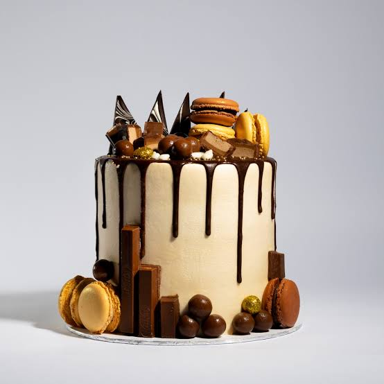

# Sweet-crumbs-bakery-by-Theo

# Sweet Crumbs Bakery Website

## Student Information

**Student Name:** Theofat Ramabulana

**Student Number:** st10489227

**Course:** Diploma in Information Technology Management

**Module:** WEDE5020

**Institution:** Rosebank College

**Year:** 2026

---

## Project Overview

Sweet Crumbs Bakery is a fictional local bakery created for this
web development project.

The purpose of the project is to design and develop a professional
website for a small bakery. The website provides information about
the bakery, its products, contact details and enquiry options.

The website will allow customers to learn more about Sweet Crumbs
Bakery and make enquiries about products and custom cake orders.

The project will be developed using HTML, CSS and JavaScript.

---
## Project Objectives

The main objectives of the Sweet Crumbs Bakery website are to:

- Provide information about Sweet Crumbs Bakery.
- Display the bakery's products in an organised way.
- Allow customers to make enquiries.
- Provide the bakery's contact information.
- Display the bakery's location using Google Maps.
- Create a website that is easy to navigate.
- Make the website responsive on desktop, tablet and mobile devices.
- Use responsive images to improve the website's performance.
- Create a consistent design across all website pages.
- Apply appropriate HTML and CSS development practices.

---
## Website Pages

The website contains the following pages:

### 1. Home Page

The homepage introduces visitors to Sweet Crumbs Bakery.

It includes:

- Bakery welcome message.
- Hero Section
- Introduction to the bakery.
- Featured products.
- Call-to-action section.
- Link to the products page.
- Link to the enquiry page.
---
### 2. About Us

The About Us page provides information about Sweet Crumbs Bakery, its purpose and its approach to providing quality baked products and customer service.

### 3. Products

The Products page displays the bakery's products.

Products include:

- Celebration Cakes
- Cupcakes
- Fresh Bread
- Pastries

Each product contains an image, heading, description and an option to make an enquiry.

### 4. Enquiry

The Enquiry page allows customers to provide their details and submit an enquiry about bakery products and services.

The form includes fields such as:

- Customer name
- Email address
- Contact number
- Product of interest
- Enquiry/message

### 5. Contact

The Contact page provides customers with ways to contact Sweet Crumbs Bakery.

It includes:

- Contact information.
- Bakery location.
- Google Maps.
- Additional contact information.

---
# Technologies Used

The following technologies were used to develop the website:

### HTML5

HTML was used to create the structure and content of the website.

Examples include:

- Headings
- Paragraphs
- Images
- Navigation links
- Forms
- Sections
- Articles
- Footer
---
### CSS3

CSS was used to style and improve the appearance of the website.

CSS was used for:

- Colours
- Fonts
- Spacing
- Layouts
- Buttons
- Product cards
- Navigation
- Responsive design
- Hover effects
- Mobile layouts
- Tablet layouts

### Git and GitHub

Git was used to keep track of changes made during the development of the website.

GitHub was used to store and manage the project online.

---
# Project Folder Structure

The project is organised using the following folder structure:
```text
Sweet-crumbs-bakery-by-Theo/
│
├── index.html
├── about.html
├── products.html
├── enquiry.html
├── contact.html
├── README.md
│
├── css/
│   └── style.css
│
├── js/
│   └── script.js
│
└── images/
    ├── bakery-small.png
    ├── bakery-medium.png
    ├── bakery-large.png
    │
    ├── birthdaycake-small.jpg
    ├── birthdaycake-medium.jpg
    ├── birthdaycake-large.jpg
    │
    ├── cake-small.jpg
    ├── cake-medium.jpg
    ├── cake-large.jpg
    │
    ├── bread-small.jpg
    ├── bread-medium.jpg
    ├── bread-large.jpg
    │
    ├── cupcake-small.jpg
    ├── cupcake-medium.jpg
    ├── cupcake-large.jpg
    │
    ├── pastries-small.jpg
    ├── pastries-medium.jpg
    └── pastries-large.jpg
---

# Changelog

## Part 2 – CSS Styling and Responsive Design

### Version 2.0 – CSS Development

The following changes were made during Part 2 of the project:

- Created an external `style.css` file for the website.
- Linked the CSS stylesheet to all five HTML pages.
- Added a CSS reset to make the website styling more consistent.
- Added a consistent font family throughout the website.
- Added suitable heading sizes and paragraph spacing.
- Created a consistent colour scheme for Sweet Crumbs Bakery.
- Added styling to the website header and navigation bar.
- Added hover and focus effects to navigation links.
- Styled the website buttons and added hover effects.
- Created a responsive hero section for the homepage.
- Used Flexbox to arrange the header and navigation elements.
- Used CSS Grid to display the bakery products.
- Added product cards with consistent spacing and styling.
- Added styling for the enquiry form.
- Added styling for the contact section.
- Added styling for the Google Maps section.
- Added footer styling.
- Added responsive breakpoints for tablets and mobile devices.
- Used relative units such as `%` and `rem` to improve responsiveness.
- Added responsive image styling using CSS.
- Added `srcset` and `sizes` attributes to product images.
- Created small, medium and large versions of the bakery images.
- Updated image file names to follow a consistent naming format.
- Corrected image file paths in the HTML code.
- Added suitable `alt` text to images for accessibility.
- Tested the images to make sure they display correctly on the website.
- Checked that the correct image size can be selected depending on the screen size.
- Tested the website at desktop, tablet and mobile screen sizes.
- Corrected spacing, image and layout issues found during testing.

## Responsive Images

Responsive images were added to improve website performance and user experience.

Three image sizes were created for the main product images:

- **Small images** – used for smaller mobile screens.
- **Medium images** – used for tablets and medium-sized screens.
- **Large images** – used for desktops and larger screens.

The `srcset` attribute was used to provide different image sizes, while the `sizes` attribute helps the browser decide which image is most suitable for the user's screen size.

Example:

```html



# Sweet Crumbs Bakery Website

## Project Overview

Sweet Crumbs Bakery is a website developed to display bakery products,
provide information about the bakery and allow customers to make enquiries
or prepare general contact messages.

The website was created using HTML, CSS and JavaScript.

## Technologies Used

- HTML5 for the structure of the website.
- CSS3 for styling, layouts and responsive design.
- JavaScript for interactive features and form validation.
- Git and GitHub for version control and project hosting.
- GitHub Pages for publishing the static website.

## Website Pages

- `index.html` - Homepage and introduction.
- `about.html` - Information about the bakery.
- `products.html` - Bakery products and product search.
- `enquiry.html` - Product enquiry form.
- `contact.html` - General contact form.

## Part 3: Functionality and SEO

### JavaScript Enhancements

- Added a welcome message to the homepage.
- Added a search feature to filter bakery products.
- Added an image lightbox for viewing product images.
- Added HTML and JavaScript form validation.
- Added an enquiry response for product-related questions.
- Added functionality to prepare a contact email.
- Added an automatic copyright year.

### Search Engine Optimisation

- Added page-specific title tags and meta descriptions.
- Used suitable heading tags to organise page content.
- Added descriptive alternative text to images.
- Improved internal links between website pages.
- Created a `robots.txt` file.
- Created a `sitemap.xml` file.
- Continued improving mobile responsiveness and image loading.

### Forms

The enquiry form collects a customer's contact details, selected
product, quantity, required date and additional requirements.

The contact form collects the customer's name, email address,
message type and general message.

HTML validation checks required fields and common input formats.
JavaScript displays feedback and prepares the contact email.

Note: The current demonstration enquiry form does not save or send
enquiries automatically. The contact form relies on the visitor's
configured email application. A backend or form service is required
for automatic processing and storage.

## Testing

The website should be tested for:

- Working navigation links.
- Correctly displayed images.
- Product search results.
- Image lightbox opening and closing.
- Required form fields and invalid input.
- Contact email preparation.
- Desktop, tablet and mobile layouts.
- Correct links and paths on the published website.
- Availability of `robots.txt` and `sitemap.xml`.

## Changelog

### Part 3 - Functionality and SEO

- Added JavaScript enhancements.
- Added product search and filtering.
- Added an image lightbox.
- Added enquiry form validation and response messages.
- Added contact form validation and email preparation.
- Improved page titles and meta descriptions.
- Reviewed image alt text and internal links.
- Created 'robots.txt'.
- Created 'sitemap.xml'.
- Added page speed and security improvements.
- Updated project documentation.

## References

Git. (n.d.) *Git documentation*. Available at:
https://git-scm.com/doc (Accessed: 28 October 2026).

Mozilla. (n.d.) *HTML: HyperText Markup Language*.
Available at: https://developer.mozilla.org/en-US/docs/Web/HTML
(Accessed: 28 October 2026).

Mozilla. (n.d.) *JavaScript*.
Available at: https://developer.mozilla.org/en-US/docs/Web/JavaScript
(Accessed: 28 October 2026).

Mozilla. (n.d.) *CSS: Cascading Style Sheets*.
Available at: https://developer.mozilla.org/en-US/docs/Web/CSS
(Accessed: 28 October 2026).

Google Search Central. (n.d.) *SEO Starter Guide*.
Available at: https://developers.google.com/search/docs/fundamentals/seo-starter-guide
(Accessed: 28 October 2026).

Sitemaps.org. (n.d.) *Sitemaps XML format*.
Available at: https://www.sitemaps.org/protocol.html
(Accessed: 28 October 2026).

 Developer.Mozilla, 2026. CSS: Cascading Style Sheets. [online]. Available at: https://developer.mozilla.org/en-US/docs/Web/CSS (accessed 15 September 2026).

 FreedomCodeCamp, 2025. How to Git and GitHub. [online]. Available at: https://www.freecodecamp.org/news/learn-how-to-use-git-and-github-a-beginner-friendly-handbook/ (accessed 17 September 2026). 

 GeeksforGeeks, 2026. HTML Introduction. [online]. Available at: https://www.geeksforgeeks.org/html/html-introduction/ (accessed 10 September 2026).

 GeeksfoeGeeks, 2026. Web Development Technologies. [online]. Available at: https://www.geeksforgeeks.org/web-tech/web-technology/ (accessed 7 September 2026).
. 
 
